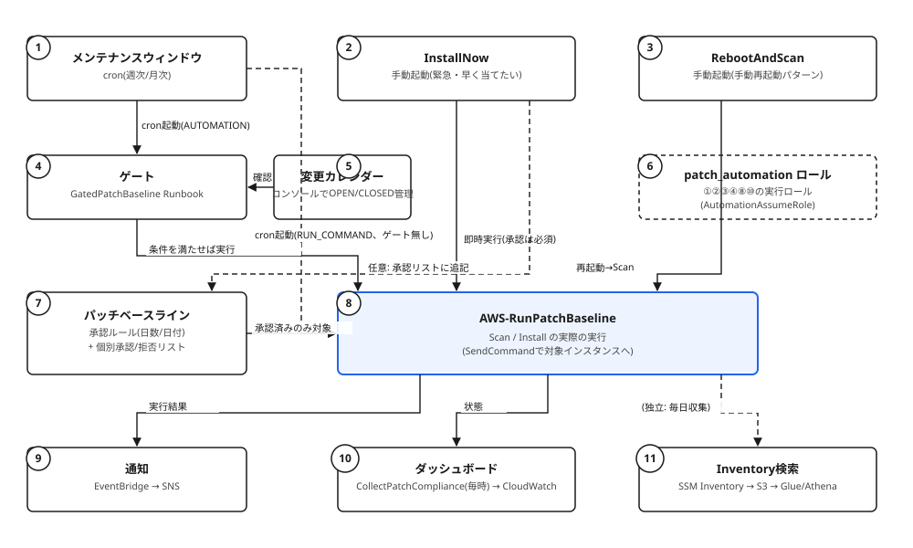

# パッチ管理基盤 移植ガイド(社内AWS環境向け)

自宅ラボ(KVM + SSM Hybrid Activation)で検証したPatch Manager基盤のうち、
**AWS側のパッチ管理関連リソース**(IAM・パッチベースライン・メンテナンス
ウィンドウ・Automation Runbook・通知・可視化)を、社内の実AWS環境
(IAMはAssumeRoleチェーン、環境ごとにフォルダ/state分割、prd infra環境の
みにデプロイ)へ移植するためのガイド。

**対象外**(自宅ラボ固有のため、このガイドでは扱わない):
VM構築(Packer/Ansible/`autounattend.xml`)、KVMの仮想ネットワーク・
nftables仮想FW。EC2側は既存のプロビジョニングフロー・ネットワークに
乗る前提とし、本ガイドは「VMが既にSSM管理対象になっている」ところから
AWS側に作るリソースだけを扱う。

参照元: `satsho/iac`リポジトリ `terraform/environments/patch-mgmt/`
(設計の全体像は同リポジトリ `docs/patch-mgmt-design.md` も参照)

---

## 0. 全体構成図



| # | 要素 | 説明 |
|---|---|---|
| ① | メンテナンスウィンドウ | スケジュール(cron)。`AUTOMATION`タイプなら④ゲートを経由、`RUN_COMMAND`タイプなら⑧へ直接(ゲート無し) |
| ② | InstallNow | 手動起動。承認(⑦への追記は任意)だけ済ませて、スケジュール・ゲートを省略して⑧を即時実行する |
| ③ | RebootAndScan | 手動起動。再起動してから⑧(Scan)を実行し、コンプライアンスを最新化する(手動再起動パターンの締め) |
| ④ | ゲート | `GatedPatchBaseline` Runbook。⑤がOPENであること、前段ステージが直近成功していること、前段に失敗/再起動待ちが残っていないことを確認し、満たさなければ中止する |
| ⑤ | 変更カレンダー | AWSコンソールの「変更カレンダー」画面でOPEN/CLOSEDを運用者が直接編集する(Terraform管理外) |
| ⑥ | patch_automationロール | ①②③④⑧⑩がAutomation/メンテナンスウィンドウの実行時に引き受けるIAMロール |
| ⑦ | パッチベースライン | 承認ルール(日数/日付、動的評価)+ 個別承認/拒否リスト(明示的なID、ベースラインに保存)。⑧が参照する「入れてよいパッチ」の唯一の判定根拠 |
| ⑧ | AWS-RunPatchBaseline | Scan/Installの実際の実行本体。①④②③のいずれの経路から来ても、最終的にここで⑦の内容に基づいてインスタンスへ適用される |
| ⑨ | 通知 | ⑧を含むメンテナンスウィンドウ/Runbookの実行結果を、EventBridge経由でSNS(メール等)に通知 |
| ⑩ | ダッシュボード | `CollectPatchCompliance`(毎時)が⑧の結果を集計し、CloudWatch Dashboardで可視化 |
| ⑪ | Inventory検索 | SSM Inventoryで日次収集したインストール済みパッケージ一覧をS3→Glue/AthenaでSQL検索可能にする(⑧の実行結果とは独立した別経路) |

---

## 1. 前提の違い

| | 自宅ラボ | 社内環境 |
|---|---|---|
| IAM | 用途ごとに新規ロールを作成 | インスタンスロールはAssumeRoleのみ許可 → 特定の強い権限ロールへ切り替え |
| Terraform構成 | 1環境1tfディレクトリ(`patch-mgmt`のみ) | 環境(prd/stg/dev等)ごとにフォルダ分割、各フォルダに個別tf/state |
| デプロイ対象 | 唯一の環境 | **prd infra環境のみ**にデプロイ |
| ノードのSSM登録 | Hybrid Activation(Terraform側でも`hybrid_node`ロールを作成) | 対象外(社内側で登録済みの前提。[3.1](#31-ノード登録のiamだけは要確認)で権限面のみ触れる) |

**結論**: パッチ管理の「仕組み(ロジック)」はOS/実行基盤に依存しないので
Terraformリソースはほぼそのまま移植できる。移植が必要なのは
「IAMロールの組み方」と「Terraformのフォルダへの当てはめ方」の2点。

---

## 2. そのまま持っていける設計(コンセプト層)

### 2.1 承認・ゲート・スケジュールの3軸モデル

- **承認(Approval)**: パッチベースラインの`approve_after_days`(または
  `approve_until_date`)で機械的に判定。省略不可。
- **ゲート(Gate)**: 直前ステージのメンテナンスウィンドウが直近N時間以内に
  成功しているか、かつ前段パッチグループにFailed/PendingRebootが残って
  いないかを確認。省略可。
- **スケジュール(Schedule)**: メンテナンスウィンドウのcron。省略可。

通常フローは3軸すべてを使い、「早く当てたい/緊急」はスケジュールと
ゲートだけを省略する(`InstallNow`)。この整理自体はAWS Patch Manager
共通の概念なので、実行基盤がEC2でもそのまま通用する。

### 2.2 パッチベースライン: 承認ルール vs 個別リスト

- `approval_rule`(分類・深刻度でフィルタ、日数/日付で判定)は**動的評価**
  (スキャン/インストールの都度評価、保存されない)
- `approved_patches`/`rejected_patches`(明示的なID列挙)は**ベースラインに
  保存される**、承認ルールより優先

RHEL/Windowsでフィルタキーが異なる点(RHEL: `SEVERITY`、Windows:
`MSRC_SEVERITY`。Windowsは`PRODUCT`で製品を絞る必要あり)もAWS側の仕様
なのでそのまま。実機で確認済みの値は下記。

| | RHEL | Windows |
|---|---|---|
| `CLASSIFICATION` | `Security`等 | `CriticalUpdates`/`SecurityUpdates`等 |
| 深刻度キー | `SEVERITY` | `MSRC_SEVERITY` |
| 深刻度の値 | `Critical`/`Important`/`Moderate`/`Low` | 同じ4値 |
| 製品指定 | 不要 | `PRODUCT=WindowsServerXXXX`必須 |

### 2.3 ゲート(Gate)の仕組み

#### 目的

前段ステージ(test/stg)のパッチ適用が「本当に無事に終わっているか」を、
次ステージ(stg/prod)のメンテナンスウィンドウが実行される直前に自動確認する。
これにより、「前段が落ちているのに次ステージだけ先に進んでしまう」事故を防ぐ。
承認(日数)が通っていても、ゲートで止まればそのステージのパッチ適用は
**実行されない**(スキップ、エラーにはならずそのまま終了)。

#### いつ動くか

メンテナンスウィンドウの`AUTOMATION`タイプのタスクとして、
対象インスタンス**ごとに1回ずつ**、ウィンドウの実行開始時に起動される
(Runbook名: `gated-patch-baseline.yaml`)。`RUN_COMMAND`タイプ
(ゲート不要な最初のステージ)はこのRunbookを経由しない。

#### 判定ロジック(2+1条件、すべて満たさないと先に進めない)

| # | 条件 | 確認に使うAPI | 満たさない場合 |
|---|---|---|---|
| 0 | (任意)指定した変更カレンダーが全てOPEN | `GetCalendarState` | 1つでもCLOSEDなら中止 |
| 1 | 前段のメンテナンスウィンドウが、直近`GateMaxAgeHours`時間以内に`SUCCESS`で終わっている | `DescribeMaintenanceWindowExecutions` | 「直近◯時間以内に実行されていない」または「直近の実行が◯◯だった」で中止 |
| 2 | 前段パッチグループの対象インスタンスに、適用失敗(`FailedCount`)・再起動待ち(`InstalledPendingRebootCount`)が残っていない | `DescribeInstancePatchStatesForPatchGroup` | 残っているインスタンスがあれば中止(手動再起動パターンの完了確認も兼ねる) |

条件1は**そのウィンドウ自身の実行履歴**を見る。前段を手動(`InstallNow`等)で
修復しても、ウィンドウ自体が実行された記録がなければ条件1は満たせない
(条件2のみ満たされる状態になる)。

#### 処理フロー

```
メンテナンスウィンドウ(stg-weekly等)の実行開始
  └─ 対象インスタンスごとに GatedPatchBaseline を起動
        ├─ Step 1: CheckPreviousStage (aws:executeScript)
        │     0. 変更カレンダーのチェック(任意)
        │     1. 前段ウィンドウの直近実行がSUCCESSか
        │     2. 前段パッチグループにFailed/PendingRebootが残っていないか
        │     → どれか満たさなければ Exception を投げて Abort(以降のStepは実行されない)
        ├─ Step 2: RunPatchBaseline (aws:runCommand)
        │     AWS-RunPatchBaseline(Operation=Install)を対象インスタンスに実行
        └─ (Automation自体の成功/失敗として記録される)
```

#### 主なパラメータ

| パラメータ | 型 | 説明 |
|---|---|---|
| `InstanceId` | String | 対象インスタンスID(メンテナンスウィンドウから`{{RESOURCE_ID}}`が自動で渡る) |
| `RebootOption` | String | `RebootIfNeeded`/`NoReboot` |
| `GateWindowIds` | String(カンマ区切り) | 前段メンテナンスウィンドウのID。**空ならゲート条件1・2自体を確認しない**(testのようにゲート不要なステージでも、カレンダーチェックのためだけにこのRunbookを使うことができる) |
| `GatePatchGroups` | String(カンマ区切り) | 前段パッチグループ名 |
| `GateMaxAgeHours` | Integer | 条件1の有効期限(時間) |
| `ChangeCalendarNames` | StringList | 条件0で確認する変更カレンダー名。空ならこの確認自体を行わない |

#### 必要なIAM権限(Runbookの実行ロール)

`ssm:DescribeMaintenanceWindowExecutions` /
`ssm:DescribeInstancePatchStatesForPatchGroup` /
`ssm:GetCalendarState` /
`ssm:SendCommand`(`AWS-RunPatchBaseline`のみに限定)

### 2.4 手動実行①: InstallNow(緊急・早く当てたい)

#### 目的・ユースケース

通常は「承認(日数)→ ゲート確認 → スケジュール(cron)」の3つが揃って
初めてパッチが入るが、以下のような**例外的に急ぐケース**に対応する。

- 既に承認条件を満たしているパッチを、次の定期ウィンドウを待たずに今すぐ入れたい
- まだ承認条件(日数)を満たしていない緊急パッチ(ゼロデイ対応等)を、
  承認待ちをスキップして今すぐ入れたい
- 本適用の前に、カナリア的に1台だけ先に入れて様子を見たい

ゲートとスケジュールは省略するが、**承認だけは省略できない**
(ベースラインに無いパッチは絶対にインストールされないというPatch Manager
自体の仕様のため)。承認する人と実行する人が同じという想定のもと、
`aws:approve`のような人の承認クリックは挟まず、**実行できる(IAM権限を
持っている)こと自体を唯一の制御**にしている。

#### 処理フロー

```
Step 1: AddApprovedPatchesIfNeeded (aws:executeScript)
  AddApprovedPatchesが空 → 何もせずスキップ(既に承認済みのものだけ入れる場合)
  AddApprovedPatchesに指定あり →
    1. GetPatchBaselineForPatchGroupでベースラインIDを取得
       ★OperatingSystemは必ず明示する(省略するとWINDOWS扱いになり、
         別オーナーのデフォルトベースラインにフォールバックする実機確認済みの不具合)
    2. GetPatchBaselineで現在のApprovedPatchesを読み出す
    3. 新規分を追記して UpdatePatchBaseline で書き戻す
       (UpdatePatchBaselineのApprovedPatchesは全置き換えAPIのため、
        読み出し→追記→書き戻しが必須。いきなり新規分だけ渡すと
        既存の個別承認が全部消える)
Step 2: RunPatchBaseline (aws:executeScript)
  InstanceIdが指定されていればその1台だけ、無ければTargetTagValuesの
  PatchGroup全体に AWS-RunPatchBaseline(Operation=Install)をSendCommand
Step 3: WaitForPatchCommand ─ コマンド完了まで待つ
Step 4: AssertPatchCommandSucceeded ─ Successであることを確認
```

#### 主なパラメータ

| パラメータ | 型 | 説明 |
|---|---|---|
| `TargetTagValues` | String | 対象のPatchGroupタグ値(環境全体に適用)。`InstanceId`指定時は省略可 |
| `InstanceId` | String | 対象を1台に絞りたい場合に指定。指定すると`TargetTagValues`より優先される |
| `AddApprovedPatches` | StringList | 緊急で承認リストに追加したいアドバイザリID等。空なら追加なし |
| `RebootOption` | String | `RebootIfNeeded`/`NoReboot` |
| `MaxConcurrency`/`MaxErrors` | String | `TargetTagValues`指定時(複数台対象)の同時実行数・失敗許容数 |

`AddApprovedPatches`と`InstanceId`を併用する場合、どのベースラインを
更新するか特定するために`TargetTagValues`も併せて指定する必要がある
(承認はインスタンス単位ではなくPatchGroup=ベースライン単位の概念のため)。

#### 実行方法

- コンソール: Systems Manager → 変更管理 → オートメーション → 対象Runbookを選択 →
  「実行」。「シンプルな実行」で`InstanceId`に直接入力すれば1台に絞れる。
  複数台へ同時実行数・失敗許容数を制御しながら流したい場合は「レート制御実行」を使う
- CLI: `aws ssm start-automation-execution --document-name <name> --parameters '...'`

#### 必要なIAM権限(Runbookの実行ロール)

`ssm:GetPatchBaselineForPatchGroup` / `ssm:GetPatchBaseline` /
`ssm:UpdatePatchBaseline` / `ssm:SendCommand`(`AWS-RunPatchBaseline`のみ) /
`ssm:ListCommands` / `ssm:GetCommandInvocation`

**この Runbook を誰が起動できるか(`ssm:StartAutomationExecution` +
`iam:PassRole`)は、社内の職務分掌要件に合わせて別途絞り込むこと**
(承認する人と実行する人が同じという前提が成立する人の範囲)。

### 2.5 手動実行②: RebootAndScan(手動再起動パターン)

#### 目的・ユースケース

`RebootOption: NoReboot`でパッチを適用する環境(prod等、メンテナンス時間外の
勝手な再起動を禁止したい環境)では、再起動が必要なパッチが入ると
`InstalledPendingReboot`(再起動待ち)のまま残る。単にOS側で再起動しただけ
では、**次のスキャンまでPatch Manager上は再起動待ちのまま**残り、次ステージの
ゲート条件2(前段にPendingRebootが残っていないこと)も通らない。この
Runbookは「再起動 → 再起動後にスキャンし直してコンプライアンスを更新」まで
1回の実行でまとめて行う。

#### 仕組み(終了コードによる間接トリガー)

`AWS-RunShellScript`/`AWS-RunPowerShellScript`は「渡されたコマンドを
そのまま実行するだけ」の汎用ドキュメントで、`AWS-RunPatchBaseline`の
`RebootOption`のような「再起動が必要かどうかを判断する」機能を持たない。
そのため、以下の**特定の終了コードを返すことでSSM Agent自身に再起動させる**
という間接的な手段を使う。

```
1回目の実行: マーカーファイル確認 → 無い → 作成 → 特定の終了コードで終了
  → SSM Agentがこの終了コードを検知 → OSを再起動
  → 再起動完了後、SSM Agentが「手元に保持している同じスクリプト」を
    (AWSに問い合わせ直すのではなく)もう一度実行する
2回目の実行(再起動後、同じコマンドの継続): マーカーファイル確認 → ある
  → 削除 → 通常の終了コード(0)で終了(ここで無限ループを防いでいる)
```

| | RHEL(`AWS-RunShellScript`) | Windows(`AWS-RunPowerShellScript`) |
|---|---|---|
| 継続トリガーの終了コード | `194` | `3010`(`ERROR_SUCCESS_REBOOT_REQUIRED`) |
| マーカーファイル | `/var/tmp/patch-reboot.marker` | `$env:SystemRoot\Temp\patch-reboot.marker` |

この挙動はSSM Agent自体の機能(AWS実装側)であり、EC2でもオンプレ
(Hybrid Activation)でも同一。**そのまま移植可**。

#### 処理フロー(Automation全体)

```
Step 1: Reboot (aws:runCommand → AWS-RunShellScript/AWS-RunPowerShellScript)
  上記の終了コードトリックで、再起動を挟みつつ最終的にSuccessで終わるまで待つ
Step 2: ScanAfterReboot (aws:runCommand → AWS-RunPatchBaseline, Operation=Scan)
  再起動後の状態でスキャンし直し、コンプライアンスを更新する
  (マーカーファイルのロジックとは無関係の、別のRun Command)
```

#### 主なパラメータ

| パラメータ | 型 | 説明 |
|---|---|---|
| `InstanceId` | String | 再起動するインスタンスID |
| `LogGroupName` | String | Run Commandの出力先ロググループ |

#### 実行方法

- 対象1台: `aws ssm start-automation-execution --document-name <name> --parameters 'InstanceId=...'`
- 対象複数台(タグ指定、同時実行数・失敗許容数を制御): `--targets Key=tag:Env,Values=prod --target-parameter-name InstanceId --max-concurrency 1 --max-errors 0`

#### 必要なIAM権限(Runbookの実行ロール)

`ssm:SendCommand`(`AWS-RunShellScript`/`AWS-RunPowerShellScript`/
`AWS-RunPatchBaseline`のみに限定) / `ssm:ListCommands` /
`ssm:GetCommandInvocation`

### 2.6 通知・可視化のパターン

- EventBridge → SNSでメンテナンスウィンドウ/Runbook結果・非準拠化を通知
- `CollectPatchCompliance`(1時間ごと)→ CloudWatch Logs → ダッシュボード
- SSM Inventory → S3 Resource Data Sync → Glue/Athena でパッケージ一覧を
  横断検索

これらもAWS標準機能の組み合わせなので、EC2環境でもそのまま使える。
(Grafana部分は自宅ラボ固有のPoCなので、社内では既存のBIツール/
QuickSight等に差し替えるのが自然)

---

## 3. 移植が必要な部分

### 3.1 ノード登録のIAMだけは要確認(対象外領域との接点)

VM/EC2のSSM登録自体はこのガイドの対象外だが、1点だけAWS側のIAM設計に
影響するため触れておく。自宅ラボは`aws_iam_role.hybrid_node`という
Hybrid Activation専用ロールを作っているが、これは**移植不要**
(対象側のインスタンスは既にSSM管理対象になっている前提のため)。

ただし、そのインスタンスが使っているロールの権限(`AmazonSSMManagedInstanceCore`
相当)が「AssumeRoleのみ許可」という社内方針の中でどう確保されているかは、
パッチ管理リソース側からは制御できない部分なので、基盤/セキュリティ担当
側で解決済みであることを前提にする(未解決なら先にそちらを確認)。

### 3.2 IAMロール: AssumeRoleチェーンへの組み込み

自宅ラボの`aws_iam_role.patch_automation`(メンテナンスウィンドウの
サービスロール兼Runbookの`AutomationAssumeRole`)は、信頼ポリシーが
`ssm.amazonaws.com`(SSMサービス自身)になっている。これは**人やEC2が
AssumeRoleする対象ではなく、AWSのSSMサービスが内部的に引き受ける
ロール**なので、「EC2ロール→強い権限ロールへの切り替え」という社内
パターンとは**層が異なる**(衝突しない)。

実際に気にすべきAssumeRoleチェーンは2つ。

1. **誰が`InstallNow`/`RebootAndScan`等のRunbookを起動できるか**
   (`ssm:StartAutomationExecution`+`iam:PassRole`で`patch_automation`
   ロールを渡す権限)。これを「強い権限ロール」側にのみ許可し、
   EC2の基礎ロールには持たせない、という設計にすれば社内方針と整合する。
2. **CI/CD(Terraform apply)がこれらのリソースを作る権限**
   (自宅ラボでは`github-actions-terraform`ロールが相当)。社内の
   Terraform実行用ロール構成に合わせて権限を追加する。

```
[人 or CI] --sts:AssumeRole--> [強い権限ロール] --ssm:StartAutomationExecution--> Automation実行
                                                   (iam:PassRole で patch_automation を渡す)
                                                        │
                                                        ▼
                                          [patch_automation ロール]
                                          (ssm.amazonaws.com が引き受ける)
                                          --sts:AssumeRole(実行時)--> Runbookの処理
```

### 3.3 Terraformのフォルダ構成への当てはめ

自宅ラボは`terraform/environments/patch-mgmt/`という単一ディレクトリ・
単一stateだが、社内は「環境ごとにフォルダ分割、各フォルダ内でさらに
機能ごとに分割、tf/stateも個別」という構成。**prd infra環境にのみ
デプロイする**という制約があるため、イメージとしては:

```
<リポジトリルート>/
└── environments/
    └── prd/
        └── infra/
            ├── patch-mgmt/          ← ここに今回のリソース一式を配置
            │   ├── patch_baseline.tf
            │   ├── patch_baseline_windows.tf
            │   ├── maintenance_window.tf
            │   ├── automation.tf
            │   ├── documents/
            │   │   ├── gated-patch-baseline.yaml
            │   │   ├── install-now.yaml
            │   │   ├── reboot-and-scan.yaml
            │   │   └── reboot-and-scan-windows.yaml
            │   ├── iam.tf            ← hybrid_node関連は削除、EC2向けに書き換え
            │   ├── notification.tf
            │   ├── dashboard.tf
            │   ├── inventory.tf
            │   ├── variables.tf
            │   ├── outputs.tf
            │   └── backend.tf        ← 社内のstate管理方式に合わせる
            └── (他の既存機能フォルダ)
```

既存の他環境(stg/dev等)には**展開しない**ことを明示するため、
このディレクトリ自体をprd infra配下にのみ作成し、他環境からは
参照されない独立したstateにするのが安全。

---

## 4. 移植時のファイル一覧とチェックリスト

| ファイル | 移植方針 |
|---|---|
| `patch_baseline.tf` / `patch_baseline_windows.tf` | ほぼそのまま。`approve_after_days`等は社内の承認ポリシーに合わせて値を変える |
| `maintenance_window.tf` | ほぼそのまま。スケジュール(曜日・時刻)は社内の運用時間に合わせる |
| `automation.tf` | ほぼそのまま。`document_names`のプレフィックス等は社内の命名規則に合わせる |
| `documents/*.yaml` | ほぼそのまま(Python/Bash/PowerShellのロジックはOS/実行基盤に非依存) |
| `iam.tf` | **要書き換え**。`hybrid_node`関連を削除、`patch_automation`の信頼ポリシー・権限は[3.2](#32-iamロール-assumeroleチェーンへの組み込み)の設計に合わせる |
| `notification.tf` / `dashboard.tf` / `inventory.tf` | ほぼそのまま(AWS標準サービスの組み合わせ) |
| `variables.tf` / `outputs.tf` | 社内の変数命名規則・tfvars運用に合わせて調整 |
| `backend.tf` | 社内のstate管理方式(S3バケット/キー/ロック方式)に差し替え |
| `docs/patch-mgmt-design.md` | 設計コンセプトの説明として参考にしつつ、社内版として書き直す |

---

## 5. 社内事情に合わせて決め直すべき設計判断

1. **承認日数(`approve_after_days`)**: 自宅ラボはtest=0/stg=1/prod=2日。
   社内のリリース/変更管理ポリシーに合わせて決める。
2. **ゲートの`max_age_hours`**: メンテナンスウィンドウの実施間隔に合わせる。
3. **`InstallNow`を実行できる人の範囲**: 「承認する人と実行する人が同じ」
   という前提が社内の職務分掌(SoD)要件と整合するか要確認。整合しない
   場合は`aws:approve`ステップの追加を検討。
4. **手動再起動(`RebootAndScan`)が必要な環境**: 自宅ラボはprodのみ
   `NoReboot`。社内の変更管理要件(メンテナンス時間外の再起動禁止等)に
   合わせて対象環境を決める。
5. **SSM Core権限の付与方法**: [3.1](#31-ノード登録のiamだけは要確認対象外領域との接点)参照、基盤/セキュリティ担当との合意が必要。
6. **可視化基盤**: Grafana(自宅ラボPoC)か、既存のQuickSight/社内BI
   ツールかを選定。

---

## 6. 移行ステップの提案

1. prd infra環境配下に`patch-mgmt`ディレクトリを新設、state/backendを設定
2. 対象インスタンスのSSM登録状況・権限([3.1](#31-ノード登録のiamだけは要確認対象外領域との接点))を基盤チームと確認
3. `iam.tf`を社内のAssumeRoleパターンに合わせて書き直す(`hybrid_node`削除)
4. `patch_baseline*.tf`/`maintenance_window.tf`の値を社内ポリシーに合わせて調整
5. 対象インスタンスのタグ付け(`PatchGroup`等)を既存運用に組み込む
6. 影響の小さい環境(まずは数台)で`terraform plan`→`apply`、
   スキャン・Install・ゲート・`InstallNow`・`RebootAndScan`を一通り検証
7. 問題なければ対象を広げる。本番適用前に`docs/patch-mgmt-design.md`の
   社内版を作成し、運用チームへ引き継ぐ

---

## 7. 手動構築する場合のリソース作成チェックリスト(Terraformを使わない場合)

Terraformを使わず、コンソール/CLIで直接作る場合の作成順(依存関係順)。
括弧内は参照元リポジトリでの対応するTerraformリソース名/ファイル名。

### 7.1 IAMロール

- [ ] **Runbook/メンテナンスウィンドウの実行ロール**(`aws_iam_role.patch_automation`相当)
  - 信頼ポリシー: `ssm.amazonaws.com`を信頼(人やEC2が直接AssumeRoleする対象ではない)
  - 権限: 下記をインラインポリシーで付与
    - `ssm:SendCommand`(リソースを`document/AWS-RunPatchBaseline`、
      `document/AWS-RunShellScript`、`document/AWS-RunPowerShellScript`、
      `managed-instance/*`に限定。他のドキュメントは実行させない)
    - `ssm:ListCommands` / `ssm:GetCommandInvocation` / `ssm:CancelCommand`
    - `ssm:DescribeInstanceInformation` / `ssm:DescribeInstancePatchStates` /
      `ssm:DescribeInstancePatchStatesForPatchGroup` / `ssm:DescribeInstancePatches`
    - `ssm:DescribeMaintenanceWindowExecutions`
    - `ssm:GetAutomationExecution` / `ssm:ListTagsForResource`
    - `ssm:GetCalendarState`(変更カレンダー連携を使う場合)
    - `ssm:GetPatchBaseline` / `ssm:GetPatchBaselineForPatchGroup` /
      `ssm:UpdatePatchBaseline`(`InstallNow`の個別承認追記用)
    - `logs:CreateLogStream` / `logs:PutLogEvents`(Run Command出力・集計用ロググループへ)
    - `cloudwatch:PutMetricData`(ダッシュボードの推移グラフ用メトリクスを出す場合)
    - `iam:PassRole`(このロール自身を対象に、`iam:PassedToService=ssm.amazonaws.com`条件付き。
      誰が実行できるかはこの権限を持つ側(強い権限ロール側)で制御する)
  - 起動できるRunbookを7.5で作成したドキュメントARNに限定する
    (`ssm:StartAutomationExecution`はこのロール自身には不要。呼び出す側
    (人/CI/強い権限ロール)に付与し、`document/`と`automation-execution/*`
    の両方のARNを許可すること)
- [ ] **(ダッシュボード用の定期実行をEventBridge Schedulerで行う場合)Schedulerロール**
  - 信頼ポリシー: `scheduler.amazonaws.com`
  - 権限: 上記Runbookロールへの`iam:PassRole` + 該当Automationへの`ssm:StartAutomationExecution`
- [ ] **(Inventory→Athena可視化を作る場合)Glueクローラ用ロール**
  - 信頼ポリシー: `glue.amazonaws.com`
  - 権限: `AWSGlueServiceRole`(AWS管理ポリシー)+ 対象S3バケットへの`s3:GetObject`/`s3:ListBucket`

### 7.2 ロググループ・通知

- [ ] CloudWatch Logsロググループ: Run Command出力用、コンプライアンス集計用、
      イベント記録用(それぞれ保持期間を決めて作成)
- [ ] SNSトピック(名前は`Automation-`で始める必要あり、`aws:approve`系の
      承認通知を将来使う場合のAWS側制約。本構成では未使用でも慣習として踏襲可)
      + メールサブスクリプション
- [ ] EventBridgeルール(3種): メンテナンスウィンドウ実行結果・Automation実行結果・
      パッチ非準拠化、それぞれのイベントパターンを設定しSNSトピックをターゲットに
      (`input_transformer`相当の変換をコンソールの「ターゲットの入力」で設定)

### 7.3 パッチベースライン

- [ ] 環境(test/stg/prod)×OS(RHEL/Windows)ごとに作成
  - 承認ルール: 分類・深刻度のフィルタ、`承認までの日数`または`承認対象の日付`
  - 個別承認/拒否リスト: 初期値は空でよい(運用中に`InstallNow`相当の手動操作で追記していく)
  - パッチグループへの登録: 対象インスタンスの`PatchGroup`タグ値と一致させる

### 7.4 スキャン・Inventory収集(State Manager Association)

- [ ] 日次スキャン: `AWS-RunPatchBaseline`(`Operation=Scan`)をPatchGroupタグ指定で
      毎日実行するAssociationを作成(**1つのAssociationのタグ値は最大5個まで**という
      AWS制限に注意。OS/環境が多ければAssociationを分割する)
- [ ] (Inventory可視化を作る場合)`AWS-GatherSoftwareInventory`のAssociationを
      全対象に対して作成 + Resource Data SyncでS3への自動エクスポートを設定

### 7.5 Automation Runbook(SSMドキュメント)

コンソールの「ドキュメント → 作成 → オートメーション」でYAMLを貼り付けて作成
(Owner: Self)。内容は本ガイド[2.3〜2.5](#23-ゲートgateの仕組み)、実体は
参照元リポジトリの`documents/*.yaml`。

- [ ] ゲート付き適用(`gated-patch-baseline.yaml`相当)
- [ ] InstallNow(`install-now.yaml`相当)
- [ ] RebootAndScan(RHEL版・Windows版、`reboot-and-scan*.yaml`相当)
- [ ] (ダッシュボードを作る場合)コンプライアンス集計(`collect-patch-compliance.yaml`相当)

### 7.6 メンテナンスウィンドウ

環境・曜日/月次サイクルごとに作成。

- [ ] メンテナンスウィンドウ本体(スケジュール、実施時間、タイムゾーン)
- [ ] ターゲット登録(タグ条件、`許可されていないターゲットでは実行しない`を有効化)
- [ ] タスク登録
  - ゲート不要なステージ: `RUN_COMMAND`で`AWS-RunPatchBaseline`を直接登録、
    または7.5のゲート付きRunbookを「ゲート設定無し」で`AUTOMATION`登録
    (変更カレンダー連携を使うなら後者が必須)
  - ゲートが必要なステージ: `AUTOMATION`でゲート付きRunbookを登録、
    パラメータに前段ウィンドウID・前段パッチグループ・有効期限時間・
    (任意)変更カレンダー名を設定

### 7.7 ダッシュボード・Inventory可視化(任意)

- [ ] CloudWatchダッシュボードをJSON定義で作成(2枚: 今の状態/推移)
- [ ] EventBridge Scheduler(または別のcron相当)でコンプライアンス集計Runbookを定期実行
- [ ] S3バケット(Inventory用、Athenaクエリ結果用)
- [ ] Glueデータベース・クローラ、Athenaワークグループ
- [ ] (任意)可視化ツール(QuickSight/Grafana等)のデータソース設定

### 7.8 変更カレンダー(任意)

- [ ] Systems Manager → 変更カレンダー画面から直接作成(Terraform/API経由は
      コンソールのGUIビルダーで編集できなくなるため非推奨)
- [ ] 7.6のゲート付きRunbookの`ChangeCalendarNames`パラメータにカレンダー名を設定
